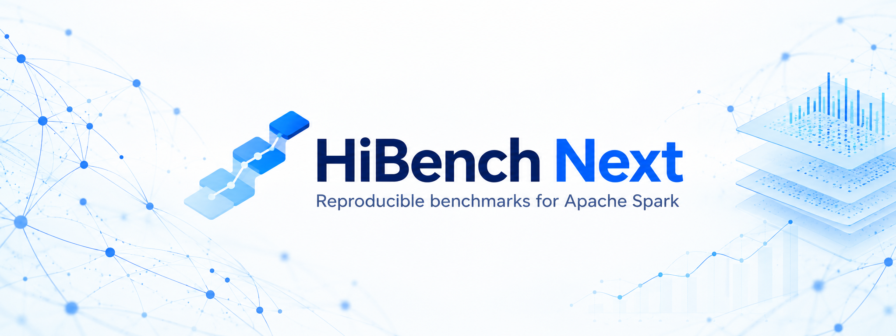

<!--
Modifications Copyright 2026 Mariano Garralda-Barrio (HiBench Next).
SPDX-License-Identifier: Apache-2.0

Licensed under the Apache License, Version 2.0 (the "License");
you may not use this file except in compliance with the License.
You may obtain a copy of the License at

    https://www.apache.org/licenses/LICENSE-2.0

Unless required by applicable law or agreed to in writing, software
distributed under the License is distributed on an "AS IS" BASIS,
WITHOUT WARRANTIES OR CONDITIONS OF ANY KIND, either express or implied.
See the License for the specific language governing permissions and
limitations under the License.
-->

# HiBench Next

[](https://doi.org/10.5281/zenodo.23400663)



## Reproducible benchmarks for Apache Spark

**HiBench Next v2.5.0** reengineers [Intel's HiBench](https://github.com/Intel-bigdata/HiBench)
around a focused **Spark batch workflow**. It brings dataset generation,
workload execution, configuration and experiment management into one coherent
system, reducing the manual setup and launch complexity of the earlier suite.

It renews **both dataset generators and
workload implementations**, corrects documented defects, replaces application
RDD boundaries with **SparkSession, DataFrames and Datasets**, and adds a shared
experiment controller accessible through a **web interface, REST API and CLI**.
The result is an open-source suite of **24 batch workloads** with explicit data
contracts, readable configuration and traceable execution records.

**v2.5.0** adds PySpark implementations of all 24 workloads and
integrated comparative analysis. Run Scala, PySpark or both over shared datasets
and workload settings, then compare recorded observations through the web UI or
REST API. Dataset generators remain Scala.

Intel's latest official release, [HiBench v7.1.1](https://github.com/Intel-bigdata/HiBench/releases/tag/v7.1.1),
and the final archived repository contain no PySpark workload implementations.
HiBench Next's contribution is modern PySpark
coverage of its 24-workload catalog and integration with shared configuration,
execution records and comparative analysis; it is not the first historical
appearance of PySpark in HiBench.

This is a community fork, not an official Intel release. The reference
environment is Spark **3.5.9**, Scala **2.12.18**, Java **11** and Hadoop **3.3.6**.
The controller and launch helpers use **Python 3**; the controller requires
**Python 3.11+**.

### User manual and documentation

Start with the **[Technical and scientific user manual (PDF, simple English)](docs/HiBench-Next-2.5.0-Technical-Scientific-Manual-EN.pdf)**.
It provides an illustrated web walkthrough, installation, Scala/PySpark execution,
API and CLI examples, configuration, resource settings, evidence interpretation
and reproducible comparison guidance for v2.5.0.

| Guide | Purpose |
| --- | --- |
| [Configuration model](docs/configuration-model.md) | Understand shared defaults, experiment overrides, target updates and persistence. |
| [Workload scales](docs/workload-scales.md) | Inspect the active input ladder, volume units, exceptions and calibration limits. |
| [Deployment](deployment/README.md) | Set up Docker Compose, persistent storage and access to the execution target. |

### From manual setup to shared experiment control

The design addresses difficulties encountered in practical benchmark use:
configuration spread across files, tedious workload parameterization and manual
preparation and submission. One authoritative `conf/` base and shared services
now connect **configuration, preparation, execution and result inspection**.
The Web UI, REST API and CLI use the same experiment model, with explicit
overrides, reusable presets and durable execution records.

The focus on Spark batch provides a common foundation for extending the suite.
SQL currently covers **scan, aggregation and join** over typed Parquet data
without a Hive metastore. Additional SQL workloads can reuse the configuration,
execution and evidence services; broader specialized SQL coverage remains
future work.

## What has changed

| Area | HiBench Next modernization |
| --- | --- |
| Workloads and generators | Maintained production code uses SparkSession/DataFrame/Dataset APIs, without application RDD calls. Replaced generators no longer require the old MapReduce autogen pipeline. |
| Scala and PySpark | All 24 catalog workloads have individual namespaced PySpark implementations. Shared workload configuration and existing launchers support Scala, PySpark or both, with independent execution evidence. |
| Comparative benchmarking | Compare implementations within a run or observations from two completed runs: conditions, duration medians, dispersion, B/A ratios, relative differences and charts. Save analysis snapshots and download JSON, CSV, offline HTML or ZIP. |
| Machine learning | Modern `spark.ml` estimators, feature vectors and statistical APIs replace legacy application `spark.mllib`/RDD readers and generation paths. Workloads that already used `spark.ml` retain it; SVD and NWeight have documented custom implementations. |
| Data loading | Explicit text, fixed-record or Parquet contracts replace legacy ObjectFile/SequenceFile boundaries where migrated. SQL runs without a Hive metastore. |
| Correctness and reproducibility | Documented generator profiles, seeds, record counts, feature dimensions and partition-dependent random streams; independent reference checks and explicit algorithm corrections. |
| Python tooling | Python 2 launch/configuration/monitoring helpers migrated to Python 3, alongside a packaged Python controller with `pyproject.toml`. |
| Web interface | Streamlit pages for experiments, shared configuration, workloads, infrastructure, live monitoring and durable run history. |
| REST API | FastAPI with Pydantic v2 input/output contracts, interactive OpenAPI documentation and shared configuration, experiment and run services. |
| CLI | Validate, resolve, install, diagnose, submit, inspect, cancel and export experiments programmatically. |
| Configuration | One authoritative `conf/` base, common Spark properties and explicit settings for six data sizes, editable workload parameters and portable YAML/JSON experiment overrides. |
| Execution and reports | Detached workers, persisted run state, cancellation/reconciliation, logs, provenance, resource graphs, HTML reports and downloadable evidence bundles. |
| Deployment | Docker Compose starts API and UI together; host-mounted configuration and reports survive recreation and connect to an existing Spark cluster. |

### Corrected behavior, not only updated dependencies

The modernization addresses concrete limitations of the earlier implementations:

- **Reproducible synthetic data:** clock-seeded or nondeterministic generation
  is replaced with explicit seed contracts where needed. Generator distributions remain the target; named input volumes are
  explicitly recalibrated in v2.5.0. Exact row identity
  is preserved where verified, and statistical equivalence is stated otherwise.
- **Usable PCA settings:** literal quotes in historical memory settings could
  reach Spark's byte parser and prevent executors from starting. Those values
  are corrected; v2.5.0 also recalibrates the default input dimensions and rows.
- **Correct NWeight propagation:** captured legacy GraphX/Pregel references
  exposed mutable vertex state and inconsistent propagation. The DataFrame
  implementation defines weighted-path propagation and top-K behavior explicitly,
  with independent checks instead of reproducing the defects.
- **Numerical and configuration boundaries:** SVD rank/conditioning behavior,
  empty evaluation cases, dimensions, seeds and effective generator settings
  are checked or documented rather than silently accepted or ignored.

Public contract fixtures and independent reference checks are available in
[tests/](tests/README.md). Detailed migration records remain in the maintainer's
local documentation.

### Preserve the benchmark's meaning

The [v2.5.0 workload scales](docs/workload-scales.md) align input volumes by
family, grow Small through Bigdata by 10x in the primary input count, and keep
ML dimensions and model settings stable from Small upward. Tiny is a smoke-test
tier; Sleep uses task duration rather than dataset bytes. This intentionally
recalibrates earlier defaults. Historical runs retain their original parameters;
scale names alone do not establish comparable inputs or resource requirements.
Linear/PCA Small and Large defaults are calibrated on the reference cluster
for approximately one minute and several minutes respectively; SVD keeps a
separate input ladder reflecting its implementation costs. Timing observations
and the remaining validation scope are documented in the scale contract.

The goal is to retain representative Spark batch workloads while making the
suite reproducible, understandable and extensible. Generator migrations account
for **logical record volume, dimensions, distributions, seeds and workload
behavior**. A switch to Parquet or text can change physical bytes and decoding
cost, and algorithm corrections can change outputs: historical elapsed times
are therefore not automatically comparable to the new suite.

Streaming and alternate framework implementations are removed to keep one
coherent Spark batch execution and validation model. New workloads can build on
the same configuration, execution and evidence services rather than introducing
another independent launch system.

## Scope and workload catalog

| Family | Workloads |
| --- | --- |
| Micro | Sleep, WordCount, Sort, TeraSort, Repartition |
| SQL | Scan, aggregation, join |
| ML | ALS, KMeans, Gaussian mixture, linear/logistic regression, Random Forest, Gradient Boosted Trees, PCA, correlation, summarizer, Naive Bayes, Linear SVM, LDA, SVD |
| Graph / web search | NWeight, PageRank |

In v2.5.0, all catalog workloads also have individual Python
implementations in `pysparkbench.<group>`. Experiments, editable presets and the
API select `scala`, `pyspark`, or `both`; generators remain Scala and workload
configuration is shared. Both prepares once and runs the two implementations
separately. PySpark uses Client; Scala retains the selected deploy mode.
See [Python implementations and validation scope](pysparkbench/README.md).

Install the numerical dependencies declared in [pyproject.toml](pyproject.toml) in the
Python environment used by the Spark driver and executors; the controller does
not need PySpark installed. See [target installation](pysparkbench/README.md#target-python-dependencies).
Functional parity checks use small fixtures and do
not certify performance or scalability at representative benchmark volumes.

Application workloads and generators use SparkSession/DataFrames/Datasets rather
than application RDD calls. ML uses modern Spark ML APIs where an estimator or
statistical API exists; custom numerical/graph implementations have explicit
contracts. SQL uses Parquet and does not require a Hive metastore. Spark's own
internal use of RDDs is outside this application-level requirement.

Streaming, alternate execution frameworks, DAL, the old MapReduce autogen and root common modules,
uncatalogued MapReduce PageRank and the optional legacy XGBoost profile are removed.
The active catalog remains 24 workloads. Compatibility with the old development
configuration/schema is not maintained. Generator volume, distributions, seeds,
partition-dependent streams and algorithm corrections are documented, including
format changes that prevent direct comparisons with historical timings.

## Start with Docker Compose

Docker with Compose and Git are the only host prerequisites for this deployment.
The image build compiles the benchmark JARs from source using Java 11 and Maven
inside Docker, and installs the Python dependencies. No local Java, Maven or
Python installation is required. Compiled JARs are generated artifacts and are
not included in the Git repository.

Start the companion [hadoop-spark-cluster Spark 3.5.9 release](https://github.com/mgarralda/hadoop-spark-cluster/releases#release-spark-3.5.9)
first, using its `spark-3.5.9` tag for the validated Spark 3.5.9 / Scala 2.12.18 /
Java 11 / Hadoop 3.3.6 environment. The companion project's current Spark 4.2
stack is a future migration target and is not supported by this release.
Configure the existing container/storage paths in `conf/`, then:

```sh
cd deployment
cp .env.example .env
# Set a generated HIBENCH_API_TOKEN in .env; never commit it.
docker compose --env-file .env -f compose.yml up -d --build --wait
```

Open http://127.0.0.1:8501 (UI) and http://127.0.0.1:8000/docs (API). The API
requires the token. In Parametrization, use **Save and update target** to save
the shared configuration and install HiBench on the target selected in Experiments.
From the CLI, use `hibench install experiment.json` before the first benchmark.
This stack starts API and UI together and connects to the already installed
Spark cluster. Host `conf/` and `report/` bind mounts retain configuration and run
records when the service is recreated. HDFS data/event-log persistence belongs to
the companion cluster. See [deployment details](deployment/README.md), including
backup, trusted-local Docker socket access and port settings.

Set `HIBENCH_CONF_HOST_DIR` and `HIBENCH_REPORT_HOST_DIR` in `deployment/.env`
to choose host directories. SQLite, run evidence and saved comparisons live under
the report mount; no separate database service is required.

## Run from a source checkout

Build with JDK 11 and Maven 3.9; on Windows the supplied PowerShell build uses Docker:

```sh
mvn -B clean package
# Windows alternative: powershell -File bin/build-java11.ps1
python -m venv .venv
# Activate your virtual environment.
python -m pip install -e .
python -m hibench.launcher --with-ui
```

`hibench-serve --with-ui` is the installed command for the same launcher.
Omit `--with-ui` to start only the API. To run only the web interface from
a checkout, use `python -m streamlit run hibench/ui/app.py`.

Or use the CLI:

```sh
hibench defaults --scale small > experiment.json
hibench validate experiment.json
hibench install experiment.json
hibench doctor experiment.json
hibench run experiment.json --wait
```

The implemented execution adapters are **Existing Docker**, **SSH** and **Local Linux**.
SSH connects to an existing Linux submission host, including the companion Docker cluster, using an authorized key/agent or `HIBENCH_SSH_PASSWORD` from the controller environment, with verified host keys. An explicit private key path takes precedence over the environment password. Credentials remain outside experiment files; only their controller-side paths are configured.
Livy, EMR, Dataproc, HDInsight, Synapse, Fabric and Databricks are visible as
planned destinations, not functioning integrations. DataFrame migration alone
is not certification for serverless platforms or provider-specific restrictions.

## Configure and reuse experiments

In **Experiments → Execution target**, select **Spark execution mode** and the
adjacent **Deploy mode**. YARN supports Client or Cluster for Scala; PySpark
uses Client in HiBench. With both implementations selected, Scala keeps the
selected YARN deployment and PySpark uses Client. Standalone uses a
`spark://host:7077` master URL and currently supports Client in HiBench.
Local uses `local[2]` on the submission host without distributed workers.
The adapter (Docker, SSH or Local Linux) selects how HiBench reaches the
submission host; it does not select Spark's cluster manager.

Spark History may contain applications from multiple modes: `local-*` indicates
local execution, `app-*` Standalone, and `application_*` YARN. Inspect the
recorded `spark.master` and `spark.submit.deployMode` to identify the effective
configuration; the ID alone does not distinguish Client from Cluster.

`conf/` is the single authoritative configuration base:

- `spark.conf`: common native Spark properties and explicit sections for tiny, small, large, huge, gigantic and bigdata. All workloads use the selected size's Spark settings. Initial resource values are conservative existing defaults, not measured sizing recommendations.
- `hibench.conf`: benchmark/launch defaults, generator partitions and monitoring.
- `hadoop.conf`: storage endpoint and Hadoop installation.
- `conf/workloads`: workload-specific sizes, generator distributions/seeds and algorithm settings.
- `benchmarks.lst`: default workload selection.

**Parametrization** separates Spark configuration, HiBench configuration and
Workloads. Inspect and edit each workload's size definitions, generator controls
and algorithm parameters, with effective values and parameter help. **Save and
update target** saves the canonical files and updates the selected destination;
a failed connection preserves the local save and offers a retry. Shared changes
are blocked during active runs.

**Experiments** follows target → workloads and data → implementation → review and
Run. Connection, SSH, runtime paths, workers and storage are edited in **Spark
Infrastructure → Target & storage**, where infrastructure profiles are managed.
Experiments can load a profile, **Check connection**, or **Update target** without
saving shared settings or starting a benchmark. The last readiness check is
invalidated when the target or local runtime changes; submission still validates
the target. Updates are blocked while runs are queued or active.
Resources, partitions, monitoring, workload parameters, execution group and Spark
properties remain optional run-only overrides. Shared defaults belong in
Parametrization. The final review shows effective deployment per implementation,
resources and override counts. Native `spark.*` keys can be
added to a size or an experiment; precedence is common base, selected size,
explicit override. Generator partition counts stay separate because they can
change random streams. No runtime recipe/configs directory is needed.
**Runs** opens with History, followed by Monitoring and Comparisons. Monitoring
shows recorded results, expandable logs, Spark History and downloads; cancellation
is available for active runs. **Reuse configuration** opens an editable draft in
Experiments without submitting another execution.
SVD additionally records explicit phase timers (`svd-phases-v1`) and numerical
library metadata in result JSON. Monitoring and Comparisons expose these timers;
comparison exports include phase CSV tables. They are separate from Spark SQL
durations and do not establish a language-specific cause. The confirmation
protocol and alternating-order campaign are documented in [tests/README.md](tests/README.md#svd-phase-confirmation).
Download an editable preset from Runs, or reuse a recorded run configuration;
import the preset to reuse a selection of multiple workloads. The API exposes
the same shared services, configuration editing, resolution, submission and exports.
The API's interactive documentation exposes its request and response contracts;
the examples below show how the three interfaces share the execution model.

## Three interfaces, one execution model

- **Web:** configure an experiment, prepare data and run workloads, inspect
  progress/logs/resource graphs, open historical runs and download reusable presets.
- **REST API:** integrate configuration inspection/editing, validation/resolution,
  submission, status, logs, cancellation and exports into external tooling. Inspect
  the Pydantic request/response contracts in [Swagger UI](http://127.0.0.1:8000/docs),
  [ReDoc](http://127.0.0.1:8000/redoc) and the [OpenAPI schema](http://127.0.0.1:8000/openapi.json).
  Use **Authorize** when HIBENCH_API_TOKEN is set. These URLs use the default API port.
- **CLI:** run the same experiment services from scripts or a terminal using the
  `hibench` command. The CLI example above includes installation and diagnostics.

All three use the shared controller and domain validation. Benchmarks execute in
workers outside HTTP requests and Streamlit reruns, while recorded configurations
and provenance remain associated with their run IDs.

The API includes shared Spark/HiBench configuration, workload sizes and parameters,
profiles, target diagnostics/installation, cluster operations, experiment import
resolution, runs, logs, metrics, monitoring samples/artifacts, reusable presets,
exports and Spark History links. Run history accepts `limit` and `offset`. Full submission models require explicit
resources and monitoring: obtain them from `GET /experiments/defaults` or resolve
an imported override through `POST /experiments/resolve`. The API does not invent
a second set of resource defaults.
`PUT /configuration/*` saves locally; `POST /diagnostics/install` updates the
selected target. Use both for the web's Save and update target workflow. Installation
is rejected while queued or active runs exist; a failed target update leaves the
local configuration saved. Comparative analysis is available through the web and
`POST /api/v1/comparisons/analyze`; save snapshots with `POST /api/v1/comparisons`
and retrieve or export them through `GET /api/v1/comparisons/{id}` and its
`/export` endpoint. Analysis does not establish statistical performance equivalence.

The web uses shared Python services directly; it does not require internal HTTP
requests to itself. **About** provides version, attribution, license notices and
API links. Generator parameter changes can change random streams and dataset
meaning; retain those settings in exported experiment conditions.

## Results and reproducibility

Runs provides durable history, console output, application IDs, metrics, resource
graphs and HTML reports, JSONL raw samples, provenance and downloadable bundles.
Spark History Server links/event-log ZIP downloads complement these reports.
Resource samples describe the configured Linux workers and may share host
counters in Docker; they are not isolated Spark task CPU measurements.
State normally lives in `report/control`, configurable with `HIBENCH_STATE_DIR`.
The manifest includes effective parameters, artifacts and configuration hashes.

### Comparative benchmarking

Open **Runs → Comparisons**, select two completed runs or select the same run
with Scala on side A and PySpark on side B. History also offers **Compare selected
runs**, and completed multilang runs offer **Compare Scala and PySpark**. Analyze
one workload or the full selection; implementations are never pooled into one
median.

The view shows recorded conditions as **Same**, **Different** or **Unknown**,
individual observations, sample counts, duration medians and standard deviations,
**B / A** ratios and relative differences. Charts show individual durations with
medians and workload ratios against a `1×` reference. Duration includes submission
and Spark startup. Incomplete phases and invalid durations are excluded;
completed observations from failed or cancelled runs remain visible with a warning.

**Save comparison** creates an analysis snapshot at
`report/control/comparisons/<comparison_id>/comparison.json`, including selections,
observations, summaries, conditions, format/analysis versions and source hashes.
Opening a snapshot checks whether its original evidence changed or became
unavailable. Download JSON, observations CSV, summary CSV, an offline HTML report
with embedded charts, or a ZIP containing all four files. Original workload
reports and run evidence remain independent.

Dataset manifest keys describe preparation conditions, not content checksums.
Runtime versions and output equivalence are not certified by this comparator.
Scala Cluster versus PySpark Client changes deployment as well as implementation;
inspect the conditions before attributing performance differences to a language.
Confidence intervals, statistical equivalence tests, physical-plan comparison and
comparative Spark task CPU/shuffle/memory analysis remain future work.

All catalog implementations are migrated, but experimental validation has limits.
Local campaign records document named tiny acceptance, 22 small workload
successes and eight selected large successes, with exceptions and explicit
integrity-check scope.
A successful small run is not proof of numerical identity with legacy algorithms,
repeated performance or capacity at larger scales. Public
[test references](tests/fixtures/README.md) and
[scientific validation tools](tests/tools/README.md) explain the available
checks. Detailed campaign receipts and raw archives remain local and are not
included in the public distribution. Historical evidence is not runtime input.

## Development, contribution and license

### Python package organization

| Location | Responsibility |
| --- | --- |
| `hibench/launcher.py` | Start the API and optionally its supervised web process (`hibench-serve`) |
| `hibench/cli.py` | Experiment commands (`hibench`) |
| `hibench/api/` | FastAPI application, HTTP routes and request/response models |
| `hibench/ui/` | Streamlit entry point (`app.py`), pages and assets |
| `hibench/parameters/` | Shared workload validation, defaults, Spark properties and scale resolution |
| `hibench/services/` | Operations shared by web, API and CLI: experiments, configuration, comparisons, clusters and monitoring |
| `hibench/adapters/` | Target execution, installation and runtime submission support |
| `hibench/config.py`, `catalog.py`, `store.py`, `worker.py`, `recovery.py` | Core experiment model, workload catalog, durable state, detached execution and recovery |

Parameter modules contain resolution and validation code; maintained values
remain in `conf/`. The UI and API call shared code instead of duplicating
configuration or execution logic.

The automated Python suite covers configuration, controller/adapters, API, UI,
monitoring and workload/evidence contracts. It uses temporary state and mocked
submission and does not require a running Spark cluster or Docker. Run it from
the repository root in a Python 3.11+ virtual environment:

```sh
python -m pip install -e ".[test]"
python -m unittest discover -s tests -v
```

Compile the JVM workloads separately with JDK 11 and Maven 3.9:

```sh
mvn -B clean package
```

Compilation does not validate workload outputs. Explicit integration checks and
scientific campaigns require the compatible cluster, built/installed artifacts
and independent result checks. They are not run by the default Python suite.

See [test scope and integration checks](tests/README.md) and [CONTRIBUTING](CONTRIBUTING.md). The project remains **Apache-2.0**; original
copyright and third-party notices are retained. HiBench Next modernization and
extensions: **Mariano Garralda-Barrio, 2025–2026**. See [LICENSE](LICENSE),
[NOTICE](NOTICE) and [CITATION.cff](CITATION.cff). Use the latter to cite the software;
no SoftwareX publication or universal scalability certification is claimed.

Scientific campaign and evidence tools live in [tests/tools](tests/tools/README.md);
`bin/` contains build scripts, maintained workload launchers and runtime/report
helpers. They are separate from the installed `hibench` application package.

The [paper evidence archive](docs/paper-evidence/README.md) provides original
Spark event logs, configurations, parsed metrics, final figures and offline
regeneration scripts for the four-case Scala/PySpark study on v2.5.0.

## Citing HiBench Next

**Author and maintainer:** Mariano Garralda-Barrio, PhD

If you use HiBench Next in research, please cite the archived **v2.5.0 software release**:

> Garralda-Barrio, M. (2026). *HiBench Next: A Heterogeneous Benchmark Suite for Modern Apache Spark* (Version v2.5.0) [Computer software]. Zenodo. https://doi.org/10.5281/zenodo.23400663

```bibtex
@software{garralda_barrio_hibench_next_2026,
  author    = {Garralda-Barrio, Mariano},
  title     = {HiBench Next: A Heterogeneous Benchmark Suite for Modern Apache Spark},
  year      = {2026},
  version   = {v2.5.0},
  publisher = {Zenodo},
  doi       = {10.5281/zenodo.23400663},
  url       = {https://doi.org/10.5281/zenodo.23400663}
}
```

Machine-readable citation metadata is provided in [CITATION.cff](CITATION.cff).
This DOI identifies the software release, not a research article or individual benchmark results.

### Version history and local evidence

Version **v1.0.0** identifies the author's earlier doctoral evolution of HiBench.
The generator/workload modernization and shared experiment controller belong
to **v2.0.0**. Earlier temporary build labels in historical receipts retain their
original values for traceability; they do not certify a later rebuilt artifact.
Version **v2.5.0** adds the Scala/PySpark catalog and integrated comparative analysis.

The October 12, 2026 closure review checked the Python/API/UI suite, the Java 11
Maven build, Python and Docker packaging, and Scala/PySpark output parity for all
24 catalog workloads using small fixtures. Browser checks covered all nine web
pages and a real multilanguage run, comparison saving and ZIP downloads. See
[validation scope](tests/README.md) for the limits of these checks; they do not
certify performance or production-scale capacity.

The October 14–15, 2026 final closure checks passed 195 Python tests, a clean
Java 11 Maven build, isolated Python source/wheel builds and a Docker image build.
The built image started API and web successfully and completed a Tiny WordCount
Scala/PySpark smoke test, saved a comparison, exported valid evidence ZIPs and
reused the run configuration. This final smoke test does not repeat the earlier
full-catalog or browser campaigns.

Public configuration and workload-scale contracts live in [docs/](docs/configuration-model.md)
and ship with the source distribution. Detailed historical and scientific archives
remain local under `docs_internal/` and `report/`. Public test guides,
fixtures and reference checks remain available under `tests/`.
See [CHANGELOG.md](CHANGELOG.md) for the v2.5.0 release scope and limitations.
